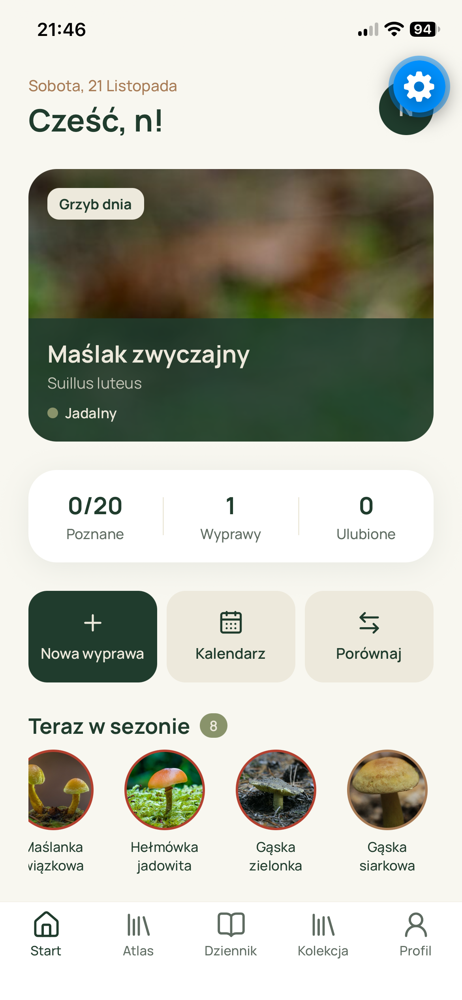
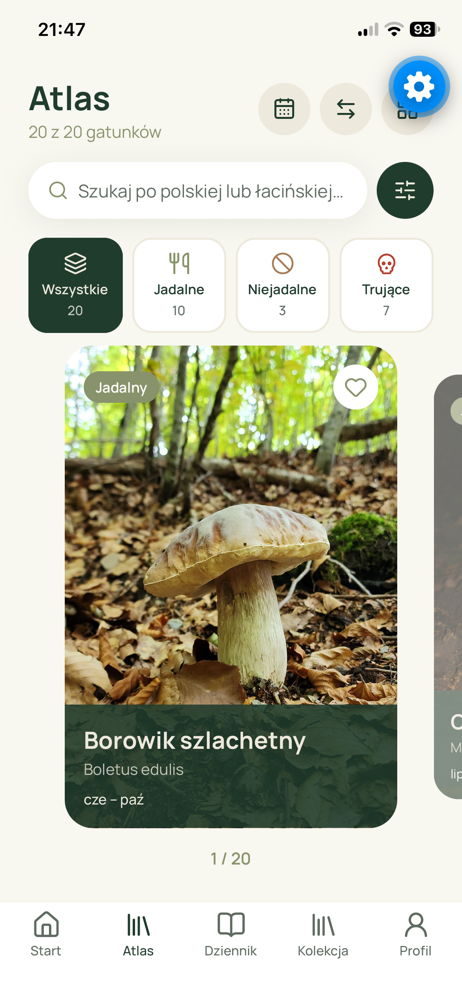
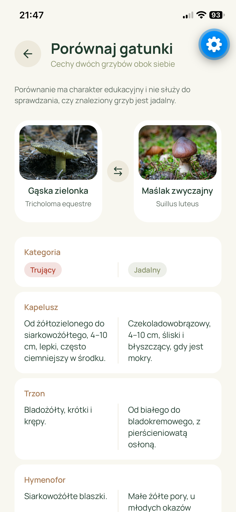
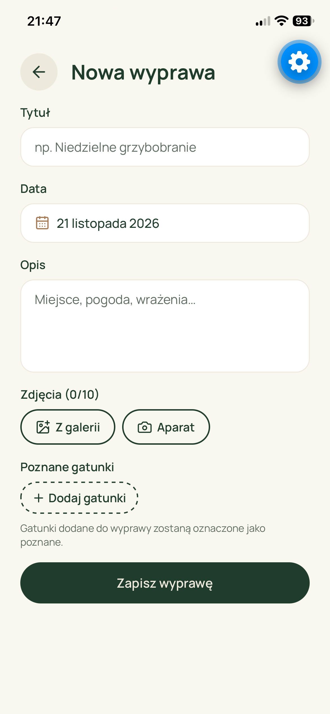
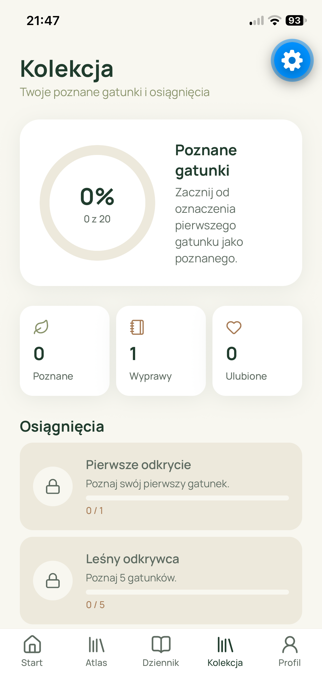
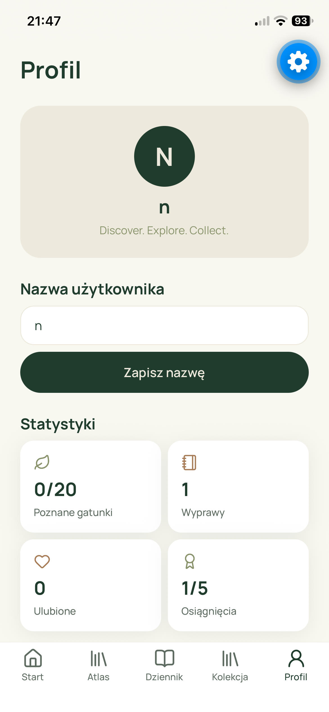

# FORESTLY

*Discover. Explore. Collect.*

FORESTLY to mobilna aplikacja dla osób zainteresowanych grzybami, napisana w React Native z użyciem Expo. Łączy atlas gatunków, dziennik wypraw do lasu, kolekcję poznanych grzybów z osiągnięciami, kalendarz sezonowości i porównywarkę gatunków.

**Aplikacja ma charakter wyłącznie edukacyjny.** Nie służy do oceny, czy dziki grzyb nadaje się do jedzenia. W razie wątpliwości nie należy go zbierać ani jeść, tylko skonsultować się z wykwalifikowanym grzyboznawcą.

## Zrzuty ekranu

<table>
  <tr>
    <td></td>
    <td></td>
    <td></td>
  </tr>
  <tr>
    <td></td>
    <td></td>
    <td></td>
  </tr>
</table>

## Funkcje

**Home**
- Data, powitanie z imieniem użytkownika, grzyb dnia (codziennie inny).
- Statystyki: poznane gatunki, wyprawy, ulubione.
- Szybkie skróty: nowa wyprawa, kalendarz, porównywarka.
- Rząd „Teraz w sezonie" i ostatnia wyprawa z dziennika.

**Atlas**
- 20 gatunków z polskimi i łacińskimi nazwami, w widoku karuzeli (z animacją) albo siatki.
- Wyszukiwanie po polskiej i łacińskiej nazwie (także bez polskich znaków).
- Kafelki kategorii: jadalne, niejadalne, trujące.
- Filtry: siedlisko, „w sezonie teraz", ulubione; sortowanie A–Z i Z–A.
- Ulubione gatunki (serduszko).
- Strona gatunku: opis, wykres sezonu, siedlisko, kapelusz, trzon, hymenofor, ciekawostki, podobne gatunki, wyraźne ostrzeżenia przy gatunkach trujących i oznaczanie gatunku jako poznanego.

**Dziennik wypraw**
- Dodawanie, edycja i usuwanie wypraw.
- Tytuł, data (własny kalendarz), opis, do 10 zdjęć (z galerii lub aparatu), gatunki poznane na wyprawie.
- Szczegóły wyprawy z powiększaniem zdjęć.

**Kolekcja**
- Pierścień postępu, statystyki, ostatnio poznane gatunki, siatka wszystkich gatunków (niepoznane są zablokowane).
- Osiągnięcia z animacją zdobycia: Pierwsze odkrycie (1 gatunek), Leśny odkrywca (5), Pasjonat grzybów (10), Kolekcjoner natury (wszystkie gatunki z atlasu), Pierwsza wyprawa.

**Kalendarz sezonowości** – wykres 12 miesięcy z liczbą gatunków w sezonie i lista gatunków dla wybranego miesiąca.

**Porównywarka** – dwa wybrane gatunki obok siebie: kategoria, kapelusz, trzon, hymenofor, siedlisko, sezon, opis.

**Profil** – zmiana nazwy użytkownika, statystyki, usuwanie wszystkich danych, informacje o aplikacji.

## Technologie

- React Native i Expo (SDK 58), TypeScript
- Expo Router (nawigacja)
- expo-sqlite (lokalna baza danych z migracjami)
- AsyncStorage (nazwa użytkownika)
- expo-image-picker i expo-file-system (zdjęcia w dzienniku)
- react-native-svg (ilustracje i pierścień postępu), lucide-react-native (ikony)
- Czcionka Manrope (@expo-google-fonts/manrope)
- Animacje z wbudowanego modułu `Animated` z React Native

## Działanie offline

Aplikacja nie wymaga internetu i nie ma backendu ani logowania.

- Dane gatunków i zdjęcia z atlasu są częścią aplikacji.
- Wyprawy, ulubione, poznane gatunki i osiągnięcia zapisują się w bazie SQLite na telefonie (migracje w `src/database/migrations.ts`).
- Zdjęcia z dziennika są kopiowane do pamięci aplikacji.
- Kod nie wykonuje żadnych zapytań sieciowych.

## Uruchomienie

Wymagania: Node.js (wersja LTS), aplikacja Expo Go na telefonie albo emulator Androida.

```bash
git clone https://github.com/gabrieldrame100-ship-it/forestly.git
cd forestly
npm install
npx expo start
```

Następnie zeskanuj kod QR w Expo Go albo naciśnij `a` w terminalu, żeby uruchomić emulator Androida. Jeśli telefon nie może połączyć się z komputerem (np. przez ustawienia sieci), użyj:

```bash
npx expo start --tunnel
```

## Platforma i testy

- Aplikacja była rozwijana i testowana na **iPhonie** z użyciem Expo Go.
- Testowano na **fizycznym urządzeniu**: tak.
- Emulator Androida: **nie testowano**.

Projekt korzysta z Expo i React Native oraz z bibliotek obsługujących zarówno iOS, jak i Androida, ale działanie na Androidzie nie zostało jeszcze sprawdzone.

## Struktura projektu

```
src/
  app/          ekrany i nawigacja (Expo Router)
  components/   komponenty wielokrotnego użytku
  constants/    kolory, czcionki, stałe
  context/      stan współdzielony (dane użytkownika, profil)
  data/         gatunki grzybów, osiągnięcia, zdjęcia
  database/     SQLite: migracje i operacje na danych
  hooks/        własne hooki
  services/     filtrowanie, daty, zapis zdjęć
  types/        typy TypeScript
assets/         zdjęcia grzybów
```
